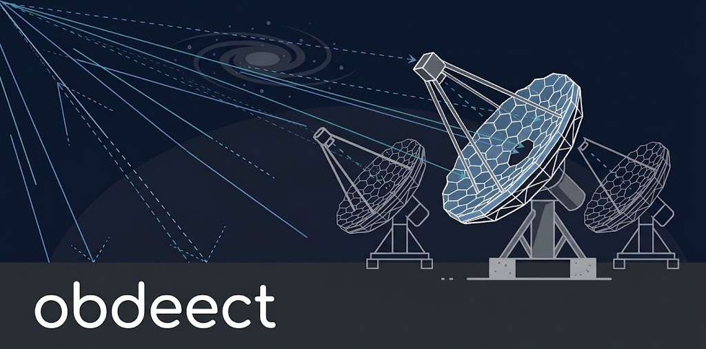

# obdeect

<p align="center">
  
</p>

[](https://doi.org/10.5281/zenodo.23942573)

obdeect is a simulation chain for imaging atmospheric Cherenkov telescopes.

The chain is made of modules that exchange photons as photon streams:

| Component | Package | Command |
|---|---|---|
| atmospheric propagation | `obdeect-propagation` | `obdeect propagation ...` |
| light sources | `obdeect-sources` | `obdeect sources ...` |
| ray tracing | `obdeect-ray-tracing` | `obdeect ray-tracing ...` |
| camera simulation | (not implemented yet) | uses sim_telarray |
| photon stream | `obdeect-stream` | `obdeect stream ...` |

[simtools](https://github.com/gammasim/simtools) configures and runs the chain.

## Install

```sh
pip install obdeect             # all components at one version
pip install obdeect-sources     # one component (also installs obdeect-stream)
obdeect --version               # installed components and photon-stream format version
```

Requires Python 3.14 or higher.

## Example

Flasher light on the dish, propagated through the atmosphere, traced through a telescope
optical model, and written as sim_telarray input:

```sh
obdeect sources flasher --type dish --photons 1e6 \
  | obdeect propagation run --transmission atm.dat --site-altitude 2156 --seed 1 -i - -o - \
  | obdeect ray-tracing trace-stream --model telescope.json --seed 7 \
  | obdeect stream to-simtel --camera-map cam.txt > sim.simtel
```

`obdeect stream to-simtel` prints the sim_telarray option (`Bypass_Optics`) to use for the
file.

## Build from source

```sh
cmake -S . -B build && cmake --build build && ctest --test-dir build
pip install ./src/stream ./src/propagation ./src/sources ./src/ray_tracing
for c in stream propagation sources ray_tracing; do pytest src/$c/python/tests; done
pytest validation   # end-to-end chain
```

Requires Python 3.14 or higher, a C++20 compiler, and CMake 3.20 or higher.

## License

BSD-3-Clause. See [LICENSE](LICENSE) and [CITATION.cff](CITATION.cff).
